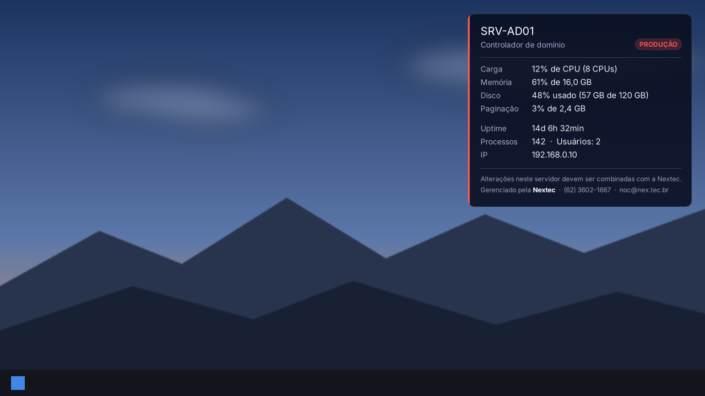

# Banner de login dos servidores

Aviso de acesso antes da senha e quadro informativo depois do login, nos servidores Linux e Windows da Nextec e dos clientes. O passo a passo completo fica no Confluence, na página "Como configurar o aviso de acesso e o banner de login nos servidores" (espaço Documentação Interna).

## Como aplicar

### Linux

Dentro da sessão SSH do servidor, ajuste as quatro variáveis e cole o bloco:

```bash
TIPO='cliente'               # cliente | nextec
NOME=''                      # Vazio = usa o hostname
FUNCAO='Servidor Escriba'
AMBIENTE='Produção'          # Produção | Homologação | Testes
curl -fsSL https://raw.githubusercontent.com/Sou-Nextec/Scripts/main/Banner/aplicar-banner.sh -o /tmp/aplicar-banner.sh
sudo TIPO="$TIPO" NOME="$NOME" FUNCAO="$FUNCAO" AMBIENTE="$AMBIENTE" bash /tmp/aplicar-banner.sh
```

O `aplicar-banner.sh` baixa os demais arquivos desta pasta, faz backup do que existe e pode ser executado de novo a qualquer momento.

### Windows

No PowerShell como administrador, dentro do servidor, edite só os quatro valores no início da linha (entre aspas) e cole a linha inteira:

```powershell
$nome=''; $funcao='Servidor Escriba'; $ambiente='Produção'; $papel='Manter'; Set-ExecutionPolicy -Scope Process -ExecutionPolicy Bypass -Force; [Net.ServicePointManager]::SecurityProtocol = [Net.SecurityProtocolType]::Tls12; & ([scriptblock]::Create((Invoke-WebRequest -UseBasicParsing 'https://raw.githubusercontent.com/Sou-Nextec/Scripts/main/Banner/aplicar-banner.ps1').Content.TrimStart([char]0xFEFF))) -Nome $nome -Funcao $funcao -Ambiente $ambiente -PapelDeParede $papel
```

O que editar:

| Valor | Opções |
| --- | --- |
| `$nome` | Vazio usa o nome real da máquina |
| `$funcao` | Texto livre, por exemplo `Servidor Escriba` |
| `$ambiente` | `Produção` (vermelho), `Homologação` (amarelo) ou `Testes` (verde) |
| `$papel` | `Manter` (painel sobre o papel de parede atual, sem alterá-lo, inclusive com GPO) ou vazio `''` (fundo preto) |

O `aplicar-banner.ps1` baixa o `quadro-windows.ps1` desta pasta, grava as variáveis, aplica o aviso antes da senha, registra a tarefa agendada que abre o painel dinâmico em cada sessão (console ou RDP) e já o abre na sessão atual. O painel é uma janela ancorada na área de trabalho, atrás das janelas e sem capturar clique, e atualiza CPU, memória, disco, paginação, uptime, processos, usuários e IP a cada 10 segundos; não gera imagem nem altera o papel de parede nem a GPO. Erros ficam em `%LOCALAPPDATA%\Nextec\quadro.log`.



O painel aparece na hora na sessão em que o instalador rodou, sem sair e entrar. Outras sessões já abertas recebem o painel ao reconectar (console ou RDP) ou desbloquear, e as novas, no login. Pode ser executado de novo a qualquer momento, e é assim que se muda nome, função, ambiente ou papel de parede depois. Para só conferir o visual, sem alterar nada: `.\quadro-windows.ps1 -SalvarEm C:\Temp\quadro.png`.

Validações: o instalador recusa Windows anterior ao 8 / Server 2012, PowerShell anterior ao 5.1 e .NET anterior ao 4.5; em Server Core aplica só o aviso antes da senha. O painel confere na própria tela se apareceu e, se não, troca sozinho o modo de ancoragem (WorkerW no Windows 8 a 11 23H2 e Server 2012 a 2022, Progman no Windows 11 24H2 e Server 2025, janela comum acima da área de trabalho como último recurso). No final, o instalador mostra o resultado dessa conferência na linha `Validação:`.

Se o painel não aparecer, o motivo fica em `%LOCALAPPDATA%\Nextec\quadro.log` do usuário (início, modo de ancoragem, conferência na tela e erros):

```powershell
Get-Content "$env:LOCALAPPDATA\Nextec\quadro.log" -Tail 10
```

Para tirar do servidor, rode esta linha no PowerShell como administrador:

```powershell
Set-ExecutionPolicy -Scope Process -ExecutionPolicy Bypass -Force; [Net.ServicePointManager]::SecurityProtocol = [Net.SecurityProtocolType]::Tls12; & ([scriptblock]::Create((Invoke-WebRequest -UseBasicParsing 'https://raw.githubusercontent.com/Sou-Nextec/Scripts/main/Banner/aplicar-banner.ps1').Content.TrimStart([char]0xFEFF))) -Remover
```

A remoção encerra os painéis, apaga a tarefa, as variáveis e a pasta, devolve o aviso antes da senha que existia antes da primeira instalação (ou apaga o aviso, se não havia) e devolve o papel de parede guardado pelo fundo preto para o usuário que rodou. Outros usuários com papel de parede guardado são listados na saída.

Os dois arquivos `.ps1` ficam salvos em UTF-8 com BOM, para o Windows PowerShell 5.1 ler os acentos.

## Arquivos

| Arquivo | Onde vai | Para quê |
| --- | --- | --- |
| `aplicar-banner.sh` | Executado uma vez | Instala tudo: variáveis, quadro, aviso e limpeza do MOTD do Ubuntu |
| `aviso-acesso.txt` | `/etc/issue.net` e `/etc/issue` | Aviso legal antes da senha (SSH e console) |
| `05-servidor` | `/etc/update-motd.d/05-servidor` | Quadro neutro para servidores de clientes, sem logotipo |
| `05-nextec` | `/etc/update-motd.d/05-nextec` | Logotipo e boas-vindas, só para servidores da Nextec |
| `10-nextec-info` | `/etc/update-motd.d/10-nextec-info` | Identificação e resumo do sistema dos servidores da Nextec |
| `aplicar-banner.ps1` | Executado uma vez | Windows: instala tudo (quadro, variáveis, aviso antes da senha e tarefa agendada) |
| `quadro-windows.ps1` | `C:\ProgramData\Nextec\Banner\` | Windows: painel dinâmico sobre a área de trabalho, com as mesmas informações do quadro Linux, atualizado a cada 10 segundos |
| `exemplos/` | | Telas de exemplo (a do Windows é da versão 2.2.0) |

## Variáveis

Gravadas pelo `aplicar-banner.sh` em `/etc/environment` (Linux) e pelo `aplicar-banner.ps1` nas variáveis de ambiente da máquina (Windows):

| Variável | O que é |
| --- | --- |
| `NEXTEC_NOME_SERVIDOR` | Nome do servidor como a Nextec o chama. Sai em caixa alta, com o hostname entre parênteses. Sem ela, aparece o hostname em caixa alta |
| `NEXTEC_FUNCAO` | Para que o servidor serve |
| `NEXTEC_AMBIENTE` | Produção (vermelho), Homologação (amarelo) ou outro valor, como Testes (verde) |
| `NEXTEC_PAPEL_DE_PAREDE` | Só no Windows. `Manter` (padrão) não mexe no papel de parede nem na GPO; `Preto` (gravado quando o instalador recebe `$papel=''`) troca o papel de parede do usuário por preto liso. `Remover` ainda é aceito e equivale a `Preto`. Para mudar depois, basta rodar o instalador de novo |
| `NEXTEC_OPACIDADE` | Opcional, só no Windows. Opacidade do fundo do painel, de 0 a 255 (padrão 230, 90%); o texto fica sempre opaco. O painel relê o valor a cada segundo, então dá para ajustar com ele aberto |
| `NEXTEC_QUADRO_LIMITE_MB` | Opcional, só no Windows. Memória máxima do processo do painel, em MB (padrão 300, mínimo 100). Acima disso o painel registra no `quadro.log` e abre um painel novo no lugar dele |

Os valores são tratados só como texto: aspas, barras, quebras de linha e caracteres de controle são ignorados.

## Testes

`testes/quadro-windows.testes.ps1` roda no CI a cada push e pull request, e também pode ser rodado à mão:

```powershell
.\Banner\testes\quadro-windows.testes.ps1
```

- Regras de código (qualquer sistema): sem `Get-NetIPConfiguration`, `Get-CimInstance` só pela sessão reaproveitada com descarte das instâncias, sem `Get-Process` no ciclo de coleta, proteção de memória ativa.
- Coleta real (só Windows): executa a coleta 360 vezes (1 hora de painel) e falha se a memória crescer mais de 20 MB ou os handles mais de 60.

Toda correção de bug no painel deve vir com um teste novo aqui, para o mesmo erro não voltar.

## Referências

- NIST SP 800-53, controle AC-8 (System Use Notification): conteúdo do aviso.
- CIS Benchmark do Ubuntu, seção "Command Line Warning Banners": aviso em `/etc/issue.net` e `/etc/issue`, sem sistema operacional nem versão, permissão 644.

## Histórico

| Versão | Data | Mudanças |
| --- | --- | --- |
| 2.1.0 | 2026-10-09 | Windows: instalador único `aplicar-banner.ps1` e `quadro-windows.ps1`, que desenha o quadro no papel de parede com as mesmas informações do Linux (cor do ambiente, carga, disco, memória, paginação, uptime, processos, usuários e IP), sem BGInfo e sem modelo binário; grupo Users resolvido pelo SID, que funciona em Windows em português |
| 2.1.1 | 2026-10-10 | Windows: o quadro é desenhado por cima do papel de parede do usuário (preservado e recuperado do histórico quando já foi sobrescrito), com painel translúcido para manter a leitura; novo parâmetro `-PapelDeParede` (Manter ou Remover) para escolher entre manter ou retirar o papel de parede |
| 2.1.2 | 2026-10-10 | Windows: mais contraste no quadro (painel mais opaco com borda leve, rótulos e rodapé mais claros, rodapé maior); opacidade ajustável por `NEXTEC_OPACIDADE` ou `-Opacidade` |
| 2.1.3 | 2026-10-10 | Windows: novas opções de fundo `Azul` (#0D0035) e `Preto` no `-PapelDeParede` (`Remover` segue valendo como `Azul`); comando de uma linha com os quatro valores editáveis no início |
| 2.1.4 | 2026-10-10 | Windows: fundo liso passa a ser só preto (`Preto`; `Remover` equivale a `Preto`; `Azul` retirado); sem papel de parede nem cor sólida, o quadro também usa preto |
| 2.2.0 | 2026-10-19 | Windows: o quadro deixa de ser imagem aplicada como papel de parede e vira um painel dinâmico (janela ancorada na área de trabalho, atrás das janelas, sem capturar clique ou foco), atualizado a cada 10 segundos, um por sessão (inclusive RDP), recriado após reinício do Explorer ou mudança de resolução; não conflita com GPO de papel de parede; `$papel=''` passa a ser o fundo preto; tarefa sem limite de tempo; novo visual com hierarquia (nome em destaque, etiqueta do ambiente, faixa lateral na cor do ambiente, métricas em amarelo a partir de 80% e vermelho a partir de 90%) e fundo translúcido com texto opaco (opacidade padrão 230); validações de sistema no instalador (Windows 8 / Server 2012, PowerShell 5.1, .NET 4.5, Server Core) e conferência do painel na tela, com troca automática do modo de ancoragem (WorkerW, Progman do 24H2, janela comum) e motivo no `quadro.log`; opção `-Remover`, que devolve o aviso anterior e o papel de parede guardado |
| 2.2.1 | 2026-10-24 | Windows: corrige o crescimento de memória e handles do painel aberto por dias (uma sessão CIM reaproveitada, instâncias CIM descartadas, IP lido por .NET no lugar do `Get-NetIPConfiguration`, processos descartados, IP, processos e usuários relidos a cada minuto); proteção que reinicia o painel acima de `NEXTEC_QUADRO_LIMITE_MB` |
| 2.0.0 | 2026-10-07 | Instalador único `aplicar-banner.sh`; aviso no padrão NIST AC-8, também no console; resumo do sistema no quadro; cor do ambiente; logotipo centralizado com separador; identificação no `10-nextec-info`; limpeza dos scripts de MOTD do Ubuntu |
| 1.0.0 | 2026-10-04 | Primeira versão: `05-nextec` (logotipo Nextec, nome real e nome Nextec do servidor) e `05-servidor` (quadro neutro para clientes, com contato noc@nex.tec.br) |
